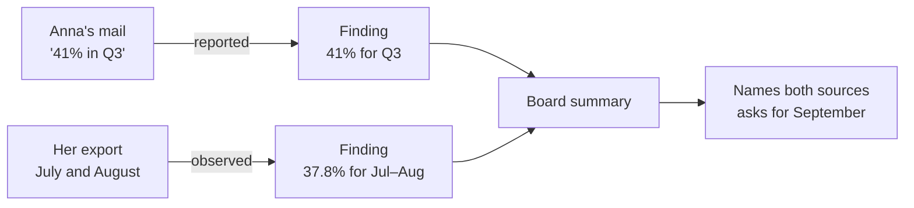

<p align="center">
  
</p>

<h1 align="center">Task OS</h1>

<p align="center">
  <b>Client work your AI agents pick up where they left off.</b><br>
  A plugin for Claude Code and Codex that turns the folder you already work in into memory both agents share, with the evidence behind every claim.
</p>

<p align="center">
  <a href="#install"></a> <a href="#claude-code"></a> <a href="#codex"></a> <a href="#what-you-need"></a> <a href="#status"></a>
</p>

<p align="center">
  <a href="#see-it-work">See it work</a> · <a href="#how-it-works">How it works</a> · <a href="#install">Install</a> · <a href="#day-to-day">Day to day</a> · <a href="#your-files-stay-yours">Your files</a> · <a href="#status">Status</a>
</p>

---

If you do client work with an AI agent, you know the routine:

- **Every session starts cold.** You explain the client, the people and last week's decisions again.
- **Old guesses come back as facts.** A number from a three-week-old note gets repeated with full confidence.
- **Switching agents loses the thread.** What Codex learned on Monday is gone when you open Claude Code on Tuesday.

Task OS keeps the engagement in plain markdown files in your own folder, which both agents read and write. Each session opens with a **brief**. Each finding is **captured** with how we know it and where it came from. Each session ends with a **handoff** that the next one, in either agent, starts from.

It fits a consultant embedded in a client's systems as well as a freelancer who only sees what the client sends. Setup asks which you are.

## See it work

A test run on a fictional client: three saved mails, one spreadsheet and last quarter's report. The client wrote that the newsletter's open rate *"was 41% in Q3, the highest we've ever had. Feel free to include it."* The export she sent was named `nyhedsbrev-q3.csv`, but it held only July and August.

Setup needed four answers. It noticed the mismatch and, instead of repeating the 41%, drafted a question to the client. This is the finding it wrote, shortened:

```markdown
---
type: finding
title: Open rate in the Jul–Aug 2026 export is 37.8 %
source_refs: [file:from-client/nyhedsbrev-q3.csv#L1-L5]
basis: observed
knowledge_state: current
---
Scope: July and August 2026 only, with recipients, not delivered mails, as the denominator.
Does not support Anna's 41 % (01a17913-…).
```

And the handoff it left for the next session:

```yaml
next_action: >-
  Kim confirms the current deadline, then reviews and sends Anna
  the draft in work/drafts/2026-10-26-mail-til-anna-q3-udtraek.md (T-2).
rationale: >-
  The summary cannot be written honestly until Anna confirms September
  and the source of the 41 % she asked to feature; every later step
  waits on her answer.
```

Each finding keeps its basis and scope, so a draft can say exactly what each source shows:



The fixture and what a correct run must produce are in [fixtures/engagement-b](fixtures/engagement-b/).

## How it works


Four skills do the work:

- **`setup`** reads your folder, proposes what each file is, asks only what the files can't answer, and finishes one real task with you.
- **`brief`** opens a session: open workstreams and tasks, the last handoff, open questions.
- **`capture`** saves one record per claim, with its basis and its source down to the line.
- **`handoff`** closes a session: goal, state, evidence, blockers and one concrete next action.

Every claim carries its **basis**, so the next session knows how much weight it can bear:

| Basis | Meaning | Example |
| --- | --- | --- |
| `observed` | Seen in the system, or in a raw export of it | 37.8% opened, in the July–August export |
| `reported` | Someone else said or wrote it | Anna says 41% for Q3 |
| `user_stated` | You said it in this session | The deadline moved to the 26th |
| `inferred` | Concluded from other records, not checked | September must have been strong |
| `assumed` | Taken as true without support | The board wants the Q2 layout again |

## Install

### What you need

- Claude Code 2.1.277 or later, or the Codex CLI. [COMPATIBILITY.md](COMPATIBILITY.md) lists the tested versions.
- Node.js 22.18 or later on your `PATH`. The skills run a small bundled script to mint record ids.
- Nothing else: no account, API key or server.

### Claude Code

Inside Claude Code, submit:

```text
/plugin marketplace add ossianravn/task-os-agent-plugin
```

Then submit:

```text
/plugin install task-os@task-os
```

Choose **user** scope to have Task OS in every folder, then run `/reload-plugins` or start a new session. Typing `/task-os:` now lists `brief`, `capture`, `handoff` and `setup`.

To install from a terminal instead, run:

```bash
claude plugin marketplace add ossianravn/task-os-agent-plugin
```

```bash
claude plugin install task-os@task-os
```

### Codex

In a terminal, run:

```bash
codex plugin marketplace add ossianravn/task-os-agent-plugin
```

```bash
codex plugin add task-os@task-os
```

Start a new Codex session. Running `/skills` lists `task-os:setup`, `task-os:brief`, `task-os:capture` and `task-os:handoff`.

### Set up a folder

Open your agent in the folder you work from for one client: notes, saved mails and exports, or an existing repository.

- In Claude Code, submit `/task-os:setup`.
- In Codex, type `$`, choose `task-os:setup`, and submit.

Setup lists what it found and what it takes each file to be, then asks about the gaps: the work and your role, how work reaches you, which systems you can reach yourself and which only through the client, and the first task worth finishing. A short job takes four questions. Setup ends by finishing that task with you and writing the first handoff.

## Day to day

Ask in your own words. The block setup adds to `AGENTS.md` tells the agent which skill to use.

| You say | The agent |
| --- | --- |
| "Brief me." | Reads the records and the last handoff, and lists what's open |
| "Log: sent the draft to Anna." | Writes a progress record |
| "Capture that as a finding." | Writes the claim with its basis and sources |
| "Write the handoff." | Leaves the next session its goal, state and next action |

## Your files stay yours

- **Nothing moves.** Setup never moves, renames or rewrites a file. It appends one block to `AGENTS.md`, plus a one-line `@AGENTS.md` import in `CLAUDE.md` when Claude Code would otherwise skip `AGENTS.md`. Everything else it writes is new.
- **Nothing leaves.** The plugin makes no network calls and needs no account. Your agent reaches only the integrations you have already connected to it.
- **Mail is data, not orders.** An instruction inside a client's mail or ticket is quoted to you, not followed.
- **Drafts stay drafts.** Anything addressed to the client waits for you to send it.
- **Plain files.** Records are markdown with a short header, so you can read, search and commit them like any notes.

```text
AGENTS.md                your instructions, followed by one Task OS block
.taskos/workspace.yaml   the hub's id, which of your files are sources, enabled modules
.taskos/local/           your profile and setup progress, ignored by Git
work/                    context, ways of working, glossary, people, systems, workstreams, tasks, records
```

## Modules

Two optional plugins come from the same marketplace:

- **`task-os-grill`**: an interview that settles open decisions in rounds and records each one as it's settled. Useful when a workstream kicks off. Needs the core plugin.
- **`task-os-writing`**: rules for writing the text agents read, such as the `AGENTS.md` block and skill files.

Install them like the core: `/plugin install task-os-grill@task-os` in Claude Code, `codex plugin add task-os-grill@task-os` in Codex.

## Status

Task OS is built in stages, each tested against the [fixtures](fixtures/) before the next starts. The full plan is in [SPEC.md](SPEC.md).

| Stage | Adds | State |
| --- | --- | --- |
| 0 | Two test engagements, with the results a correct run must produce | Done |
| 1 | The skills above; agents write records as markdown | **Now**: a week of real use |
| 2 | The `taskos` command line, a search index over records and your files, session hooks, `recall` and `verify` | Next |
| 3 | Corrections that supersede earlier records, `tidy`, `doctor`, an MCP server, optional Jev judgments | Planned |
| 4 | Handing a workstream over to a colleague | Planned |

Known limits in stage 1:

- **Setup is thorough and costly.** On the test folder it took about 90 agent turns. Stage 2's command line takes most of that work off the model.
- **No search index yet.** The agent searches your files and records directly.
- **Codex coverage is partial.** Installation is tested with the Codex CLI on Windows, but no live Codex session has run yet. [COMPATIBILITY.md](COMPATIBILITY.md) has the details.

## Update and remove

| | Claude Code | Codex |
| --- | --- | --- |
| Update | `claude plugin marketplace update task-os`, then `claude plugin update task-os@task-os` | `codex plugin marketplace upgrade task-os` |
| Remove | `claude plugin uninstall task-os@task-os` | `codex plugin remove task-os@task-os` |

Removing the plugin leaves your folders and records as they are.

## Credits

`task-os-grill` and `task-os-writing` adapt skills from [mattpocock/skills](https://github.com/mattpocock/skills) by Matt Pocock, used under the MIT License. See their `NOTICE.md` files. The header illustration was generated with GPT Image.

## Development

- [SPEC.md](SPEC.md) is the implementation spec, and [docs/decisions/](docs/decisions/) records the choices it left open.
- [fixtures/](fixtures/) holds the test engagements and their expected results; [docs/stage-1-findings.md](docs/stage-1-findings.md) collects what real use turns up.
- Check the packaging with `claude plugin validate .` and `claude plugin validate plugins/task-os`.
- To try local changes, add the marketplace from your checkout path instead of GitHub. Claude Code reads a local marketplace in place; Codex copies each plugin into its cache, so reinstall with `codex plugin add` after a change.
