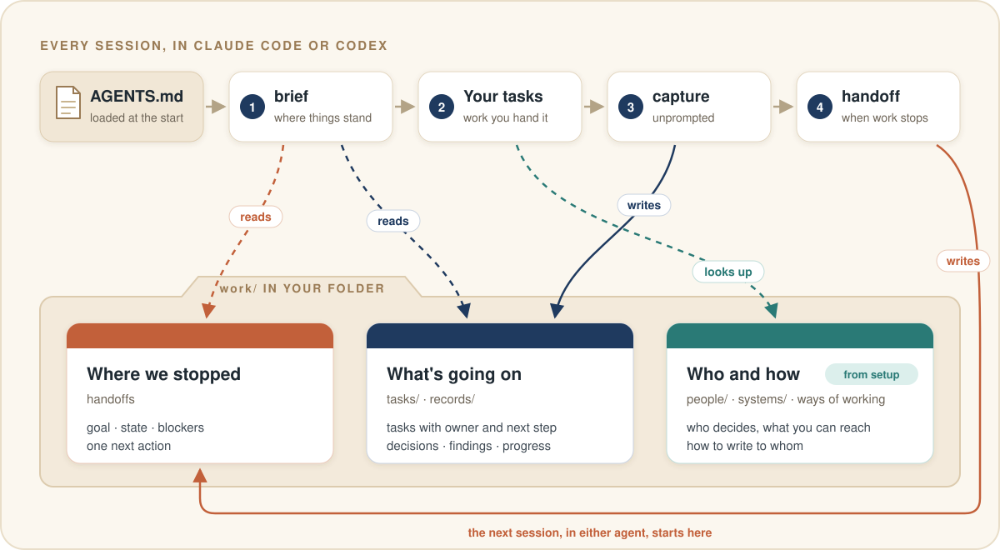
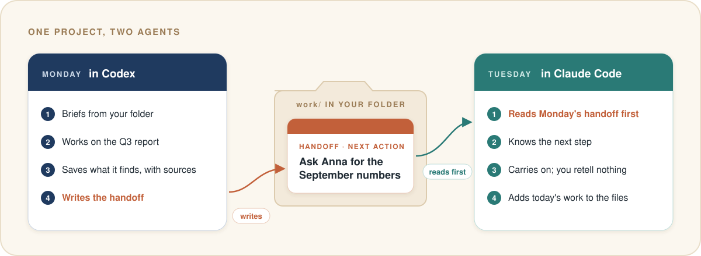
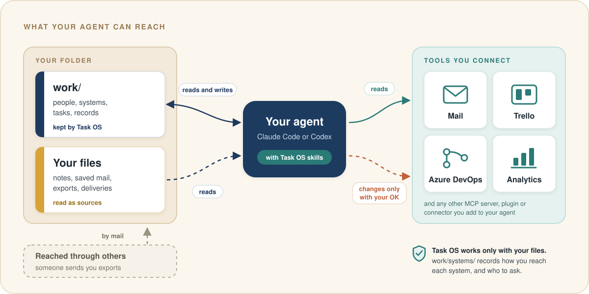
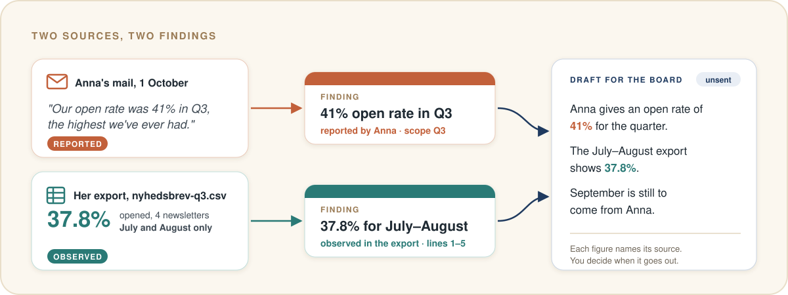

<p align="center">
  
</p>

<h1 align="center">Task OS</h1>

<p align="center">
  <b>Your assistant for projects and tasks, in Claude Code and Codex.</b><br>
  It knows the project, does the work you hand it, keeps track of every task and decision, and picks up tomorrow where you left off today.
</p>

<p align="center">
  <a href="#install"></a> <a href="#claude-code"></a> <a href="#codex"></a> <a href="#what-you-need"></a> <a href="#status"></a>
</p>

<p align="center">
  <a href="#a-day-with-task-os">A day with Task OS</a> · <a href="#how-it-gets-there">How it gets there</a> · <a href="#see-it-work">See it work</a> · <a href="#install">Install</a> · <a href="#your-files-stay-yours">Your files</a> · <a href="#status">Status</a>
</p>

---

Task OS turns Claude Code or Codex into an assistant for one project: your part of a team's work inside a company, a client assignment, or a job that comes back every quarter. You give it tasks in plain words. It does the legwork, drafts what goes out for you to send, and keeps the books on its own: what's open, who's waiting on whom, what was decided, and what every number rests on.

Everything lives as plain files in the folder you already work from, so the assistant you open tomorrow, in either agent, knows what today's did.

## A day with Task OS

| When | You | Your assistant |
| --- | --- | --- |
| Morning | Open Claude Code or Codex in the project folder | Briefs you before anything else: what's open, what's waiting on whom, and the next step from the last handoff |
| A mail arrives | "Anna sent the September numbers." | Reads them, saves each figure with its source, notes that the waiting task can move, and tells you in one line |
| Work | "Draft the Q3 summary for the board." | Writes it in Anna's format and the board's language, names the source of each figure, and records the draft |
| In passing | "Anna needs it by Friday now." | Moves the deadline on the task and notes that Anna said so |
| Evening | "That's it for today." | Writes the handoff: goal, state, blockers and one next action |

It keeps the books as it goes, and you can still say "log this" whenever you want something kept. Tomorrow you can open Codex instead of Claude Code, or the other way round; the brief is the same.

## How it gets there

Task OS is four skills, a short block in your `AGENTS.md`, and plain files in a `work/` folder. Your agent does the work with its own model and tools. Task OS gives it the project, a routine, and a place to write things down.

<p align="center">
  
</p>

### It knows the project

`setup` reads your folder (notes, saved mail, exports, any instructions already there) and asks you about the gaps the files leave. It writes what it learns into `work/`: who each person is and whether they decide, recommend or just need to know; each system and whether you open it yourself or someone sends you extracts; how each audience wants to hear from you; and the project's own terms. Claude Code and Codex both load `AGENTS.md` when a session starts, and the Task OS block in it tells them to search these files before saying anything about the project.

<details>
<summary>In the files: <code>work/people/anna-vinther.md</code>, from the test run</summary>

```yaml
role: Marketingansvarlig (marketing manager), Nordlys Cykler
authority: decides
channels: [email]
preferences: One page, because several board members read it on a phone;
  "klik" and "mål" instead of CTR and KPI; send the summary to her and she
  forwards it to the board (mail/2026-07-20-re-nyhedsbrevet-i-2-kvartal.eml:14-18).
```

Every preference points at the lines it came from.
</details>

**Limit:** it knows what's in the folder and what you've told it. Anything else it has to look up through the tools you connect.

### It does the work you hand it

The work is done by Claude Code or Codex, with their own model and the tools you've connected. Task OS gives it the people, rules and history to work with. Anything addressed to someone else follows `work/ways-of-working.md`: the reader's language and format, the source of every number named, and a draft rather than a sent message.

<details>
<summary>In the files: the board's entry in <code>work/ways-of-working.md</code></summary>

```markdown
### The board (bestyrelsen), Nordlys Cykler
- Channel: through Anna only; nothing goes to the board directly.
- Language: Danish.
- Format: one page. Several members read it on a phone.
- Words: write "klik" and "mål", not abbreviations such as CTR and KPI.
```
</details>

**Limit:** the quality of the work is your agent's. Draft-first is a written rule both agents follow. If you connect a mail tool, your agent's own permission prompts are what stand between a draft and a sent mail.

### It keeps track of every task and decision

The `capture` skill carries a list of what a good assistant keeps, and the agent saves each item the moment it comes up:

- a fact from a mail, ticket, export or meeting note, with its source
- a decision, and who made it
- new work: a request, a promise you made, a follow-up, a deadline
- a change: done, blocked, waiting on someone, a moved deadline
- anything that contradicts an earlier record
- how someone wants things done
- a deliverable drafted, sent or delivered

After each save it tells you in one line what it kept, so you can watch the books being kept.

<details>
<summary>In the files: <code>work/tasks/T-2-get-the-missing-q3-data-from-anna.md</code>, shortened</summary>

```yaml
title: Get the missing Q3 data from Anna
task_status: active
outcome: Anna has confirmed whether newsletters went out in September,
  where the 41 % open rate comes from, and whether delivered mails and
  unsubscribes can be added to the export.
next_action: Kim reviews and sends Anna the draft in work/drafts/….
depends_on: [T-1]
```

A ticket from Jira or Azure DevOps keeps its last seen status and the date it was seen. A status change found there comes to you as a proposal.
</details>

**Limit:** in stage 1, keeping the books rests on the agent following its instructions; stage 2 adds checks. The records hold what reached a file, and every record is a plain file you can read, so a gap is easy to spot.

### It picks up tomorrow where you left off

When the work stops or you sign off, `handoff` writes the session's goal, state, blockers and one next action. The next session, in either agent, loads the same `AGENTS.md`, runs `brief` first, and reads that handoff in full along with the open tasks and questions, in under 1,500 tokens. Everything lives in your folder, which is why switching agents works.

<p align="center">
  
</p>

**Limit:** in stage 1 the brief and the handoff happen because `AGENTS.md` asks for them. If a session ends abruptly, the next brief starts from the last handoff that was written.

### It works with your tools

<p align="center">
  
</p>

Your agent reaches your mail, Trello, Azure DevOps, analytics or anything else through the connections you set up in Claude Code or Codex: MCP servers, plugins or connectors. Task OS itself works only with the files in your folder. Setup records each system the project depends on and how you reach it: yourself through a connection, through a colleague who sends you exports, or out of reach. That tells the agent where to look and whom to ask. When it reads a ticket or a mail, it saves what it saw with a pointer back (`ticket:WEB-42`, `mail:<message-id>`) and the date. Changing anything there, such as sending a mail or moving a card, waits for your OK.

**Limit:** stage 1 takes your word for which connections work. From stage 3, `doctor` checks each one: configured, visible to the agent, signed in, the right board or mailbox answering, and used for real.

### It checks before it claims

Every claim carries its **basis**, so the next session knows how much weight it can bear:

| Basis | Meaning | Example |
| --- | --- | --- |
| `observed` | Seen in the system, or in a raw export of it | 37.8% opened, in the July–August export |
| `reported` | Someone else said or wrote it | Anna says 41% for Q3 |
| `user_stated` | You said it in this session | The deadline moved to Friday |
| `inferred` | Concluded from other records, awaiting a check | September must have been strong |
| `assumed` | Taken as true on trust | The board wants the Q2 layout again |

A figure from a mail stays what someone said until a source shows it. [See it work](#see-it-work) shows what that changes.

### What's automatic today

| Step | What makes it happen in stage 1 | From stage 2 |
| --- | --- | --- |
| Your agent loads the project's instructions | Claude Code and Codex read `AGENTS.md` when a session starts | Same |
| The brief at the start | The `AGENTS.md` block asks for it | A session-start hook runs it |
| Keeping the records current | The `AGENTS.md` block and the `capture` skill's list of what to keep | Same, and the `taskos` command checks every record it writes |
| The handoff when work stops | The `AGENTS.md` block asks for it | A stop hook asks for it when it's missing |
| Finding things | The agent searches your files and records | A search index across both, with `recall` |
| Checking connections | Your word, recorded at setup | `doctor` checks each one (stage 3) |

## See it work

A test run on a fictional project: a quarterly newsletter report, with three saved mails, one spreadsheet and last quarter's report. Anna, who asked for the report, wrote that the open rate *"was 41% in Q3, the highest we've ever had. Feel free to include it."* The export she sent was named `nyhedsbrev-q3.csv`, but it held only July and August.

Setup needed four answers. It noticed the mismatch and, instead of repeating the 41%, drafted a question to Anna.

<p align="center">
  
</p>

This is the finding it wrote, shortened:

```markdown
---
type: finding
title: Open rate in the Jul–Aug 2026 export is 37.8 %
source_refs: [file:from-client/nyhedsbrev-q3.csv#L1-L5]
basis: observed
knowledge_state: current
---
Scope: July and August 2026 only, with recipients, not delivered mails, as the denominator.
Does not support Anna's 41 % (01a17913-…).
```

And the handoff it left for the next session:

```yaml
next_action: >-
  Kim confirms the current deadline, then reviews and sends Anna
  the draft in work/drafts/2026-10-26-mail-til-anna-q3-udtraek.md (T-2).
rationale: >-
  The summary cannot be written honestly until Anna confirms September
  and the source of the 41 % she asked to feature; every later step
  waits on her answer.
```

The test project and what a correct run must produce are in [fixtures/project-b](fixtures/project-b/).

## Why it exists

Task OS grew out of real consulting work run this way: a project folder, an `AGENTS.md` with house rules, a project log and a handoff file, with Claude doing the legwork. It worked. It was also fragile. The log kept growing, and every session had to reread it. The house rules lived in that one folder and would have to be written again for the next project. And once, a number read from the wrong column of a log reached the client before anyone checked it against the source that could settle it.

Task OS keeps what worked and gives it structure: a record for each claim, task and decision, the evidence attached, and a brief instead of a long reread. The same setup works for your own tasks inside a company, for a team, or for clients.

## Install

### What you need

- Claude Code 2.1.277 or later, or the Codex CLI. [COMPATIBILITY.md](COMPATIBILITY.md) lists the tested versions.
- Node.js 22.18 or later on your `PATH`. The skills run a small bundled script to mint record ids.
- That is all. Task OS runs on the files in your folder.

### Claude Code

Inside Claude Code, submit:

```text
/plugin marketplace add ossianravn/task-os-agent-plugin
```

Then submit:

```text
/plugin install task-os@task-os
```

Choose **user** scope to have Task OS in every folder, then run `/reload-plugins` or start a new session. Typing `/task-os:` now lists `brief`, `capture`, `handoff` and `setup`.

To install from a terminal instead, run:

```bash
claude plugin marketplace add ossianravn/task-os-agent-plugin
```

```bash
claude plugin install task-os@task-os
```

### Codex

In a terminal, run:

```bash
codex plugin marketplace add ossianravn/task-os-agent-plugin
```

```bash
codex plugin add task-os@task-os
```

Start a new Codex session. Running `/skills` lists `task-os:setup`, `task-os:brief`, `task-os:capture` and `task-os:handoff`.

### Set up a folder

Open your agent in the folder you work from for one project: notes, saved mails and exports, or an existing repository.

- In Claude Code, submit `/task-os:setup`.
- In Codex, type `$`, choose `task-os:setup`, and submit.

Setup lists what it found and what it takes each file to be, then asks about the gaps: the work and your role, how work reaches you, which systems you can reach yourself and which only through someone else, and the first task worth finishing. A short job takes four questions. Setup ends by finishing that task with you and writing the first handoff.

## Your files stay yours

- **Your files stay put.** Setup keeps every existing file where it is, byte for byte. It appends one block to `AGENTS.md`, plus a one-line `@AGENTS.md` import in `CLAUDE.md` when Claude Code needs it to read `AGENTS.md`. Everything else it writes is new.
- **Everything stays local.** The plugin works with the files in your folder, on your machine. Your agent reaches the tools you've connected to it, and only those.
- **Mail is data.** An instruction inside a mail or ticket is quoted to you, and you decide what happens.
- **Plain files.** Records are markdown with a short header, so you can read, search and commit them like any notes.

```text
AGENTS.md                your instructions, followed by one Task OS block
.taskos/workspace.yaml   the hub's id, which of your files are sources, enabled modules
.taskos/local/           your profile and setup progress, ignored by Git
work/                    context, ways of working, glossary, people, systems, workstreams, tasks, records
```

## Modules

Two optional plugins come from the same marketplace:

- **`task-os-grill`**: an interview that settles open decisions in rounds and records each one as it's settled. Useful when a workstream kicks off. Needs the core plugin.
- **`task-os-writing`**: rules for writing the text agents read, such as the `AGENTS.md` block and skill files.

Install them like the core: `/plugin install task-os-grill@task-os` in Claude Code, `codex plugin add task-os-grill@task-os` in Codex.

## Status

Task OS is built in stages, each tested against the [fixtures](fixtures/) before the next starts. The full plan is in [SPEC.md](SPEC.md).

| Stage | Adds | State |
| --- | --- | --- |
| 0 | Two test projects, with the results a correct run must produce | Done |
| 1 | The skills above; the assistant writes records as markdown | **Now**: a week of real use |
| 2 | The `taskos` command line, search across records and your files, automatic brief and handoff, `recall`, `verify` and `task` | Next |
| 3 | Corrections that replace earlier records, `tidy`, `doctor`, an MCP server, optional Jev judgments | Planned |
| 4 | Handing a workstream over to a colleague | Planned |

Known limits in stage 1, beyond those under [How it gets there](#how-it-gets-there):

- **Setup is thorough and costly.** On the test folder it took about 90 agent turns. Stage 2's command line takes most of that work off the model.
- **Codex coverage is partial.** Installation is tested with the Codex CLI on Windows; the first live Codex session is still ahead. [COMPATIBILITY.md](COMPATIBILITY.md) has the details.

## Update and remove

| | Claude Code | Codex |
| --- | --- | --- |
| Update | `claude plugin marketplace update task-os`, then `claude plugin update task-os@task-os` | `codex plugin marketplace upgrade task-os` |
| Remove | `claude plugin uninstall task-os@task-os` | `codex plugin remove task-os@task-os` |

Removing the plugin leaves your folders and records as they are.

## Credits

`task-os-grill` and `task-os-writing` adapt skills from [mattpocock/skills](https://github.com/mattpocock/skills) by Matt Pocock, used under the MIT License. See their `NOTICE.md` files. The header illustration was generated with GPT Image; the diagrams are hand-drawn SVG in [assets/](assets/).

## Development

- [SPEC.md](SPEC.md) is the implementation spec, and [docs/decisions/](docs/decisions/) records the choices it left open.
- [fixtures/](fixtures/) holds the test projects and their expected results; [docs/stage-1-findings.md](docs/stage-1-findings.md) collects what real use turns up.
- Check the packaging with `claude plugin validate .` and `claude plugin validate plugins/task-os`.
- To try local changes, add the marketplace from your checkout path instead of GitHub. Claude Code reads a local marketplace in place; Codex copies each plugin into its cache, so reinstall with `codex plugin add` after a change.
