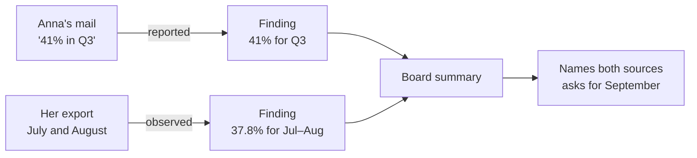
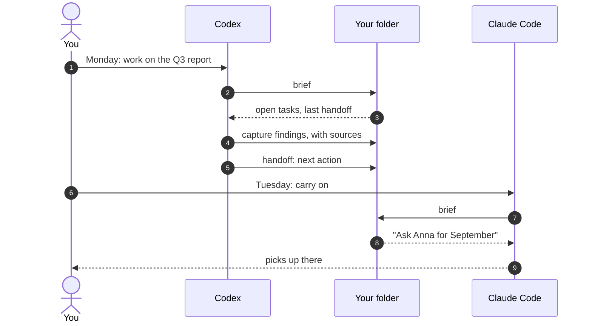

<p align="center">
  
</p>

<h1 align="center">Task OS</h1>

<p align="center">
  <b>Your assistant for projects and tasks, in Claude Code and Codex.</b><br>
  It knows the project, does the work you hand it, keeps track of every task and decision, and picks up tomorrow where you left off today.
</p>

<p align="center">
  <a href="#install"></a> <a href="#claude-code"></a> <a href="#codex"></a> <a href="#what-you-need"></a> <a href="#status"></a>
</p>

<p align="center">
  <a href="#a-day-with-task-os">A day with Task OS</a> · <a href="#see-it-work">See it work</a> · <a href="#how-it-works">How it works</a> · <a href="#install">Install</a> · <a href="#your-files-stay-yours">Your files</a> · <a href="#status">Status</a>
</p>

---

Task OS turns Claude Code or Codex into an assistant for one project: your part of a team's work inside a company, a client assignment, or a job that comes back every quarter. You give it tasks in plain words. It does the legwork, drafts what goes out for you to send, and keeps the books: what's open, who's waiting on whom, what was decided, and what every number rests on.

Everything lives as plain files in the folder you already work from, so the assistant you open tomorrow, in either agent, knows what today's did.

## What your assistant does

- **Knows the project.** Who decides and who only needs to be told, how each person wants to hear from you, which systems you can open yourself and which only through someone else, and the project's own terms.
- **Does the work you hand it.** Analyses, replies, ticket text, summaries for your manager or a board, written for the person who will read them, in their language.
- **Keeps track.** Every task with its owner, status and next step; every decision with who made it; every session closed with a note on where things stand.
- **Checks before it claims.** Each finding says how we know it and where it came from, down to the line. A figure someone mentioned in a mail is kept as what they said, not as fact.
- **Asks before anything leaves.** It drafts; you send. Its standing rules are written in your folder, where you can change them.

## A day with Task OS

| When | You say | Your assistant |
| --- | --- | --- |
| Morning | "Brief me." | Lists what's open, what's waiting on whom, and the next step from yesterday's handoff |
| A mail arrives | "Anna sent the September numbers. Log it." | Saves the numbers as findings, each with its source |
| Work | "Draft the Q3 summary for the board." | Writes it in Anna's format and the board's language, naming the source of each figure |
| A new request | "Add a task: check the subject-line test." | Creates the task with owner, outcome and next step |
| Evening | "Write the handoff." | Leaves tomorrow's session the goal, the state, the blockers and one next action |

Tomorrow you can open Codex instead of Claude Code, or the other way round. The brief is the same.

## See it work

A test run on a fictional project: a quarterly newsletter report, with three saved mails, one spreadsheet and last quarter's report. Anna, who asked for the report, wrote that the open rate *"was 41% in Q3, the highest we've ever had. Feel free to include it."* The export she sent was named `nyhedsbrev-q3.csv`, but it held only July and August.

Setup needed four answers. It noticed the mismatch and, instead of repeating the 41%, drafted a question to Anna. This is the finding it wrote, shortened:

```markdown
---
type: finding
title: Open rate in the Jul–Aug 2026 export is 37.8 %
source_refs: [file:from-client/nyhedsbrev-q3.csv#L1-L5]
basis: observed
knowledge_state: current
---
Scope: July and August 2026 only, with recipients, not delivered mails, as the denominator.
Does not support Anna's 41 % (01a17913-…).
```

And the handoff it left for the next session:

```yaml
next_action: >-
  Kim confirms the current deadline, then reviews and sends Anna
  the draft in work/drafts/2026-10-26-mail-til-anna-q3-udtraek.md (T-2).
rationale: >-
  The summary cannot be written honestly until Anna confirms September
  and the source of the 41 % she asked to feature; every later step
  waits on her answer.
```

Each finding keeps its basis and scope, so a draft can say exactly what each source shows:



The fixture and what a correct run must produce are in [fixtures/project-b](fixtures/project-b/).

## How it works

You run `setup` once in your project folder. It reads what's there, asks what the files can't tell it, and writes down the project: the people, the systems, the open work, and how you want things done. After that, four skills keep the assistant on track:

| Skill | What it does |
| --- | --- |
| `brief` | Opens a session: open workstreams and tasks, the last handoff, open questions |
| `capture` | Saves one record per claim, task or decision, with its source; `log` for quick notes |
| `handoff` | Closes a session: goal, state, evidence, blockers and one concrete next action |
| `setup` | Adopts a folder, or reconciles it after changes |

A short block in `AGENTS.md` tells the agent to brief at the start, capture as it goes, and hand off before it stops. Both agents read that file, and both read and write the same records:



Every claim carries its **basis**, so the next session knows how much weight it can bear:

| Basis | Meaning | Example |
| --- | --- | --- |
| `observed` | Seen in the system, or in a raw export of it | 37.8% opened, in the July–August export |
| `reported` | Someone else said or wrote it | Anna says 41% for Q3 |
| `user_stated` | You said it in this session | The deadline moved to the 26th |
| `inferred` | Concluded from other records, not checked | September must have been strong |
| `assumed` | Taken as true without support | The board wants the Q2 layout again |

## Why it exists

Task OS grew out of real consulting work run this way: a project folder, an `AGENTS.md` with house rules, a project log and a handoff file, with Claude doing the legwork. It worked. It was also fragile. The log kept growing, and every session had to reread it. The house rules lived in that one folder and would have to be written again for the next project. And once, a number read from the wrong column of a log reached the client before anyone checked it against the source that could settle it.

Task OS keeps what worked and gives it structure: a record for each claim, task and decision, the evidence attached, and a brief instead of a long reread. Nothing in it is specific to consulting; the same setup works for your own tasks inside a company or a team.

## Install

### What you need

- Claude Code 2.1.277 or later, or the Codex CLI. [COMPATIBILITY.md](COMPATIBILITY.md) lists the tested versions.
- Node.js 22.18 or later on your `PATH`. The skills run a small bundled script to mint record ids.
- Nothing else: no account, API key or server.

### Claude Code

Inside Claude Code, submit:

```text
/plugin marketplace add ossianravn/task-os-agent-plugin
```

Then submit:

```text
/plugin install task-os@task-os
```

Choose **user** scope to have Task OS in every folder, then run `/reload-plugins` or start a new session. Typing `/task-os:` now lists `brief`, `capture`, `handoff` and `setup`.

To install from a terminal instead, run:

```bash
claude plugin marketplace add ossianravn/task-os-agent-plugin
```

```bash
claude plugin install task-os@task-os
```

### Codex

In a terminal, run:

```bash
codex plugin marketplace add ossianravn/task-os-agent-plugin
```

```bash
codex plugin add task-os@task-os
```

Start a new Codex session. Running `/skills` lists `task-os:setup`, `task-os:brief`, `task-os:capture` and `task-os:handoff`.

### Set up a folder

Open your agent in the folder you work from for one project: notes, saved mails and exports, or an existing repository.

- In Claude Code, submit `/task-os:setup`.
- In Codex, type `$`, choose `task-os:setup`, and submit.

Setup lists what it found and what it takes each file to be, then asks about the gaps: the work and your role, how work reaches you, which systems you can reach yourself and which only through someone else, and the first task worth finishing. A short job takes four questions. Setup ends by finishing that task with you and writing the first handoff.

## Your files stay yours

- **Nothing moves.** Setup never moves, renames or rewrites a file. It appends one block to `AGENTS.md`, plus a one-line `@AGENTS.md` import in `CLAUDE.md` when Claude Code would otherwise skip `AGENTS.md`. Everything else it writes is new.
- **Nothing leaves.** The plugin makes no network calls and needs no account. Your agent reaches only the integrations you have already connected to it.
- **Mail is data, not orders.** An instruction inside a mail or ticket is quoted to you, not followed.
- **Plain files.** Records are markdown with a short header, so you can read, search and commit them like any notes.

```text
AGENTS.md                your instructions, followed by one Task OS block
.taskos/workspace.yaml   the hub's id, which of your files are sources, enabled modules
.taskos/local/           your profile and setup progress, ignored by Git
work/                    context, ways of working, glossary, people, systems, workstreams, tasks, records
```

## Modules

Two optional plugins come from the same marketplace:

- **`task-os-grill`**: an interview that settles open decisions in rounds and records each one as it's settled. Useful when a workstream kicks off. Needs the core plugin.
- **`task-os-writing`**: rules for writing the text agents read, such as the `AGENTS.md` block and skill files.

Install them like the core: `/plugin install task-os-grill@task-os` in Claude Code, `codex plugin add task-os-grill@task-os` in Codex.

## Status

Task OS is built in stages, each tested against the [fixtures](fixtures/) before the next starts. The full plan is in [SPEC.md](SPEC.md).

| Stage | Adds | State |
| --- | --- | --- |
| 0 | Two test projects, with the results a correct run must produce | Done |
| 1 | The skills above; the assistant writes records as markdown | **Now**: a week of real use |
| 2 | The `taskos` command line, search across records and your files, automatic brief and handoff prompts, `recall`, `verify` and `task` | Next |
| 3 | Corrections that replace earlier records, `tidy`, `doctor`, an MCP server, optional Jev judgments | Planned |
| 4 | Handing a workstream over to a colleague | Planned |

Known limits in stage 1:

- **The routine depends on the agent following `AGENTS.md`.** Briefing at the start and handing off at the end become automatic with the hooks in stage 2.
- **Setup is thorough and costly.** On the test folder it took about 90 agent turns. Stage 2's command line takes most of that work off the model.
- **No search index yet.** The assistant searches your files and records directly.
- **Codex coverage is partial.** Installation is tested with the Codex CLI on Windows, but no live Codex session has run yet. [COMPATIBILITY.md](COMPATIBILITY.md) has the details.

## Update and remove

| | Claude Code | Codex |
| --- | --- | --- |
| Update | `claude plugin marketplace update task-os`, then `claude plugin update task-os@task-os` | `codex plugin marketplace upgrade task-os` |
| Remove | `claude plugin uninstall task-os@task-os` | `codex plugin remove task-os@task-os` |

Removing the plugin leaves your folders and records as they are.

## Credits

`task-os-grill` and `task-os-writing` adapt skills from [mattpocock/skills](https://github.com/mattpocock/skills) by Matt Pocock, used under the MIT License. See their `NOTICE.md` files. The header illustration was generated with GPT Image.

## Development

- [SPEC.md](SPEC.md) is the implementation spec, and [docs/decisions/](docs/decisions/) records the choices it left open.
- [fixtures/](fixtures/) holds the test projects and their expected results; [docs/stage-1-findings.md](docs/stage-1-findings.md) collects what real use turns up.
- Check the packaging with `claude plugin validate .` and `claude plugin validate plugins/task-os`.
- To try local changes, add the marketplace from your checkout path instead of GitHub. Claude Code reads a local marketplace in place; Codex copies each plugin into its cache, so reinstall with `codex plugin add` after a change.
