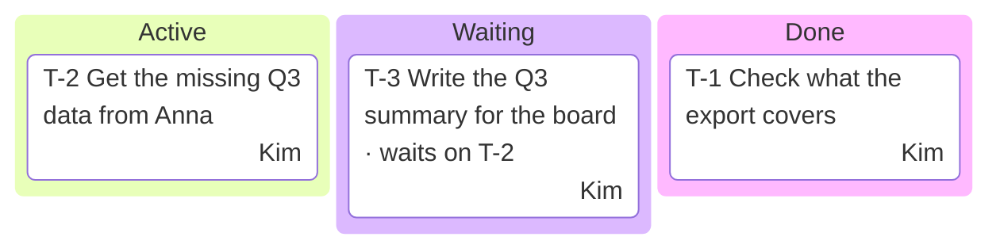
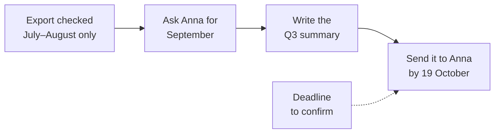

# The project board

When the Pele Board is installed, its `show_diagram` tool is available in the session, and Task OS keeps the project on a live board in the user's browser. The board is a view: every diagram is drawn from the records in `work/`, and the board lives in memory for one session, so `brief` draws it again at the start of each one.

Draw two diagrams, always with these ids, so each update replaces the one before:

## `taskos-tasks`: the tasks by status

- Title: `Tasks · <workspace name>`. Caption: the next step, in one sentence.
- A Mermaid `kanban` with the columns that have cards, in this order: Active, Waiting, Backlog, Done.
- One card per task: `T-<n> <title>`, plus `· waits on <what>` for a waiting task. Put the owner's first name in `assigned`, and a ticket's key in `ticket` when the task tracks one.
- Done holds the five most recently finished tasks.

## `taskos-plan`: where we stopped

- Title: `Where we stopped`. Caption: the handoff's next action.
- A Mermaid `flowchart LR` drawn from the newest handoff: up to two steps just finished (`:::done`), the next action (`:::active`), the steps after it (`:::todo`), and each blocker (`:::blocked`) with a dashed arrow to the step it holds up.
- Labels of one to four words; detail belongs in the caption.

## When to draw

- `brief`: both diagrams, after the written brief, then one line with the board's address.
- `capture`: `taskos-tasks` again once per reply that created or changed a task, after the last save.
- `handoff`: `taskos-plan` from the handoff of the workstream worked on last, and `taskos-tasks`.
- `setup`: both diagrams once the first task and its handoff are written.

When `show_diagram` reports an error, fix the Mermaid at the line it names and draw again. Leave the four status classes unstyled; the board colours them for light and dark mode.
